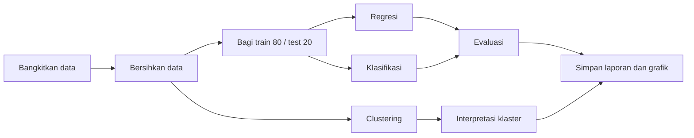
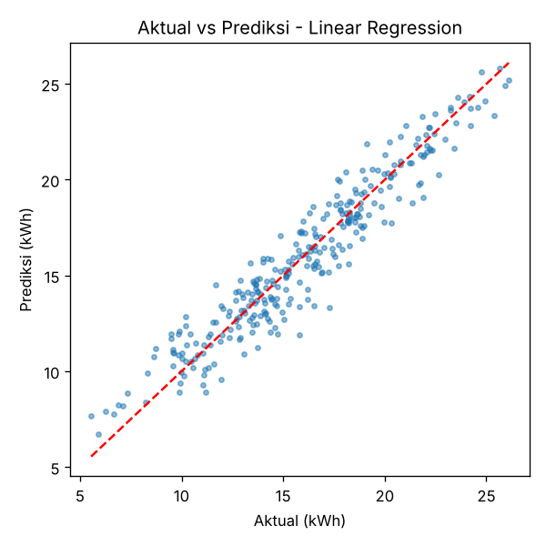
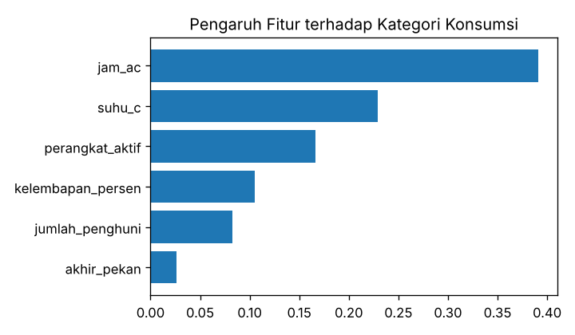
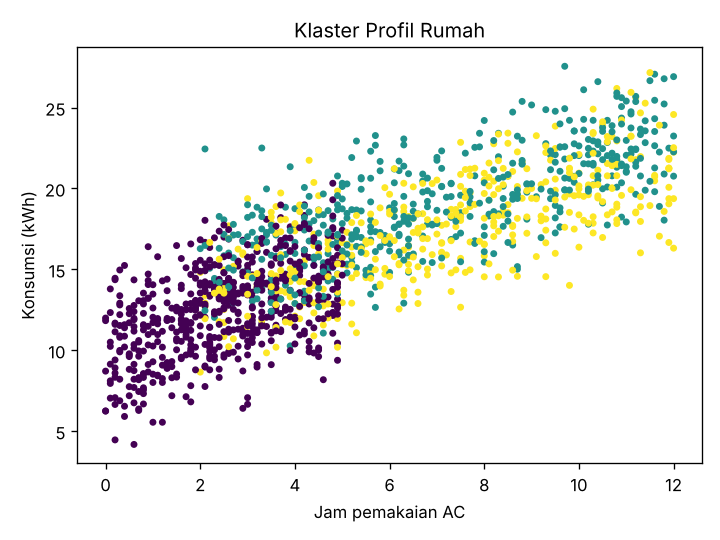

<div align="center">

# ⚡ Smart Home Energy ML

### Studi Kasus Machine Learning: Prediksi dan Pengelompokan Konsumsi Listrik Rumah Pintar (IoT)


*Regresi, klasifikasi, dan clustering dalam satu proyek sederhana.*

</div>

---

## 📑 Daftar Isi

1. [Latar Belakang](#-latar-belakang)
2. [Rumusan Masalah](#-rumusan-masalah)
3. [Tujuan](#-tujuan)
4. [Batasan Masalah](#-batasan-masalah)
5. [Hubungan dengan Materi](#-hubungan-dengan-materi)
6. [Dataset](#-dataset)
7. [Alur Kerja](#-alur-kerja)
8. [Struktur Proyek](#-struktur-proyek)
9. [Cara Menjalankan](#-cara-menjalankan)
10. [Hasil Eksperimen](#-hasil-eksperimen)
11. [Analisis dan Pembahasan](#-analisis-dan-pembahasan)
12. [Tantangan dan Etika](#-tantangan-dan-etika)
13. [Pengembangan Lanjutan](#-pengembangan-lanjutan)

---

## 🌍 Latar Belakang

Rumah pintar (*smart home*) berbasis **Internet of Things (IoT)** memiliki sensor suhu, kelembapan, dan meteran listrik yang terus merekam data. Data tersebut dapat dimanfaatkan **Machine Learning** untuk memahami pola pemakaian listrik, sehingga penghuni dapat memperkirakan tagihan dan menekan pemborosan.

Studi kasus ini menunjukkan bagaimana tiga teknik utama Machine Learning diterapkan pada satu masalah nyata yang sama.

## ❓ Rumusan Masalah

1. Berapa konsumsi listrik harian (kWh) sebuah rumah berdasarkan kondisi lingkungan dan kebiasaan penghuni?
2. Apakah suatu rumah tergolong **Hemat**, **Normal**, atau **Boros** pada hari tertentu?
3. Adakah kelompok profil rumah dengan karakteristik pemakaian yang mirip?
4. Faktor apa yang paling memengaruhi konsumsi listrik?

## 🎯 Tujuan

- Membangun model **regresi** untuk memprediksi nilai konsumsi listrik.
- Membangun model **klasifikasi** untuk menentukan kategori konsumsi.
- Menerapkan **clustering** untuk menemukan profil rumah tanpa label.
- Mengevaluasi model dengan metrik yang sesuai jenis masalahnya.

## 🚧 Batasan Masalah

| No | Batasan |
|----|---------|
| 1 | Data bersifat **sintetis** (dibangkitkan program) sehingga tidak mewakili rumah sungguhan. |
| 2 | Satuan data adalah **konsumsi harian** per rumah, bukan per jam. |
| 3 | Hanya **6 fitur**: suhu, kelembapan, jumlah penghuni, perangkat aktif, jam pemakaian AC, dan penanda akhir pekan. |
| 4 | Kategori Hemat, Normal, dan Boros ditentukan dari **persentil data** (33% dan 66%), bukan standar resmi PLN. |
| 5 | Algoritma dibatasi pada Linear Regression, Random Forest, dan K-Means (tanpa Deep Learning). |
| 6 | Tidak ada penyetelan hyperparameter lanjutan dan tidak ada penerapan *real-time*. |
| 7 | Proyek berfokus pada pembelajaran konsep, bukan sistem siap produksi. |

## 📚 Hubungan dengan Materi

| Materi | Penerapan di Proyek |
|--------|---------------------|
| Supervised learning | Regresi dan klasifikasi memakai data berlabel |
| Unsupervised learning | K-Means mengelompokkan rumah tanpa label |
| Regresi | Prediksi nilai numerik `konsumsi_kwh` |
| Klasifikasi | Prediksi kategori Hemat / Normal / Boros |
| Clustering | Profil rumah berdasarkan kemiripan |
| Pembagian training dan testing | 80% latih, 20% uji |
| Metrik evaluasi | MAE, R², Accuracy, Precision, Recall, F1-score |
| Kualitas data | Data dibersihkan dengan batas nilai wajar (*clipping*) |
| Tantangan (overfitting, bias, privasi) | Dibahas pada bagian [Tantangan dan Etika](#-tantangan-dan-etika) |

## 🗂 Dataset

Dibangkitkan otomatis oleh `src/data.py` (1.500 baris) dan disimpan ke `data/konsumsi_listrik.csv`.

| Kolom | Keterangan | Jenis |
|-------|------------|-------|
| `suhu_c` | Suhu luar ruangan (°C) | Fitur |
| `kelembapan_persen` | Kelembapan udara (%) | Fitur |
| `jumlah_penghuni` | Jumlah orang di rumah (1 sampai 6) | Fitur |
| `perangkat_aktif` | Jumlah perangkat listrik menyala | Fitur |
| `jam_ac` | Lama pemakaian AC (jam) | Fitur |
| `akhir_pekan` | 1 jika akhir pekan, 0 jika bukan | Fitur |
| `konsumsi_kwh` | Konsumsi listrik harian | **Target regresi** |
| `kategori` | Hemat / Normal / Boros | **Target klasifikasi** |

## 🔄 Alur Kerja



## 📁 Struktur Proyek

```
smart-home-energy-ml/
├── main.py                 # Program utama (seluruh alur ML)
├── src/
│   ├── __init__.py
│   └── data.py             # Pembangkit dataset
├── data/
│   └── konsumsi_listrik.csv
├── output/
│   ├── hasil_evaluasi.txt
│   ├── regresi_aktual_vs_prediksi.png
│   ├── klasifikasi_fitur_penting.png
│   └── clustering_profil_rumah.png
├── requirements.txt        # Daftar pustaka
├── .gitignore
└── README.md
```

## ▶️ Cara Menjalankan

1. Ekstrak file ZIP, lalu buka folder proyek di editor kode seperti VS Code atau PyCharm.
2. Pastikan pustaka pada `requirements.txt` sudah terpasang di lingkungan Python Anda.
3. Buka `main.py`, lalu tekan tombol **Run**.
4. Hasil evaluasi tampil di layar, dan grafik tersimpan otomatis di folder `output/`.

### Mengunggah ke GitHub (tanpa terminal)

1. Masuk ke GitHub, lalu buat repositori baru bernama `smart-home-energy-ml`.
2. Pilih **uploading an existing file**.
3. Seret seluruh isi folder hasil ekstrak (bukan file ZIP-nya) ke halaman tersebut.
4. Tekan **Commit changes**.

## 📊 Hasil Eksperimen

Hasil dari satu kali pelaksanaan (data dan pembagian bersifat tetap lewat `random_state=42`).

### 1. Regresi

| Model | MAE (kWh) | R² |
|-------|-----------|-----|
| **Linear Regression** | **0,993** | **0,910** |
| Random Forest | 1,170 | 0,881 |



### 2. Klasifikasi (Random Forest)

| Metrik | Nilai |
|--------|-------|
| Accuracy | 0,783 |
| Precision (macro) | 0,778 |
| Recall (macro) | 0,782 |
| F1-score (macro) | 0,778 |



### 3. Clustering (K-Means, k = 3)

| Klaster | Rata-rata penghuni | Rata-rata perangkat | Rata-rata jam AC | Rata-rata kWh |
|---------|-------------------|---------------------|------------------|---------------|
| 0 | 3,27 | 13,81 | 2,49 | 12,45 |
| 1 | 3,61 | 13,61 | 7,01 | 18,95 |
| 2 | 3,42 | 12,60 | 7,11 | 17,55 |



## 🔍 Analisis dan Pembahasan

- **Linear Regression lebih unggul dari Random Forest** pada kasus ini. Hal ini wajar karena data sintetis dibangkitkan dari hubungan yang hampir linear. Pada data dunia nyata yang hubungannya tidak linear, hasilnya bisa berbeda, sehingga pemilihan algoritma harus menyesuaikan karakteristik data.
- **Rata-rata kesalahan sekitar 1 kWh** dari konsumsi harian kisaran 12 sampai 19 kWh, dengan R² sekitar 0,91. Model menjelaskan sebagian besar variasi konsumsi.
- **Jam pemakaian AC adalah faktor paling berpengaruh** (0,391), disusul suhu luar (0,229) dan jumlah perangkat aktif (0,166). Penanda akhir pekan paling kecil pengaruhnya.
- **Klasifikasi mencapai akurasi sekitar 78%.** Kesalahan umumnya terjadi di kelas Normal yang berbatasan dengan Hemat dan Boros, karena batas kategori ditentukan persentil.
- **Clustering memisahkan satu kelompok pengguna AC rendah** (klaster 0, konsumsi terendah) dari dua kelompok pengguna AC tinggi (klaster 1 dan 2) yang konsumsinya lebih besar. Perbedaan klaster 1 dan 2 lebih halus dan perlu ditelaah dengan fitur lain.

## ⚠️ Tantangan dan Etika

| Tantangan | Kaitan dengan Proyek |
|-----------|----------------------|
| Kualitas data | Hasil model sepenuhnya bergantung pada kualitas data masukan. |
| Overfitting | Dicegah dengan memisahkan data uji yang tidak dipakai saat pelatihan. |
| Bias | Data sintetis dapat tidak mewakili kondisi rumah yang beragam. |
| Privasi | Data konsumsi listrik asli dapat mengungkap kebiasaan penghuni, jadi harus dikelola dengan izin dan perlindungan yang jelas. |
| Pengawasan manusia | Prediksi bersifat pendukung keputusan, bukan pengganti pertimbangan penghuni. |
| Evaluasi berkala | Model perlu dievaluasi ulang bila pola pemakaian berubah. |

## 🚀 Pengembangan Lanjutan

- Memakai data konsumsi listrik asli dari meteran pintar.
- Menambah fitur waktu seperti jam, musim, dan hari libur.
- Mencoba Gradient Boosting atau jaringan saraf tiruan (Deep Learning).
- Menerapkan validasi silang dan penyetelan hyperparameter.
- Membuat antarmuka web sederhana untuk memantau prediksi.

---

<div align="center">

Yovanza Villareal - G1A023054

</div>
